# Configuración de un servidor DNS paso a paso

1. [Control de versiones](#1-control-de-versiones)

## 1. Control de versiones

Lo primero es crear un repositorio en GitHub con el nombre `dns-paso-a-paso` y configurarlo como **privado**.

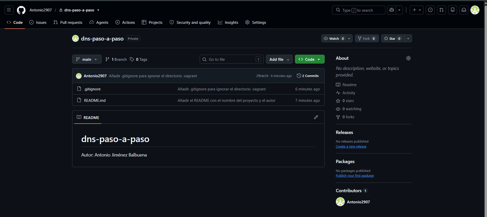

Después se crea el fichero `README.md` con la información del proyecto: el nombre y el autor.
A continuación se crea el fichero `.gitignore` para que Git ignore el directorio `.vagrant/`, que Vagrant genera en local y no debe subirse al repositorio.
Cada cambio se confirma en un commit propio, con un mensaje que explica su propósito
Por último se enlaza el repositorio local con el de GitHub y se suben los commits:

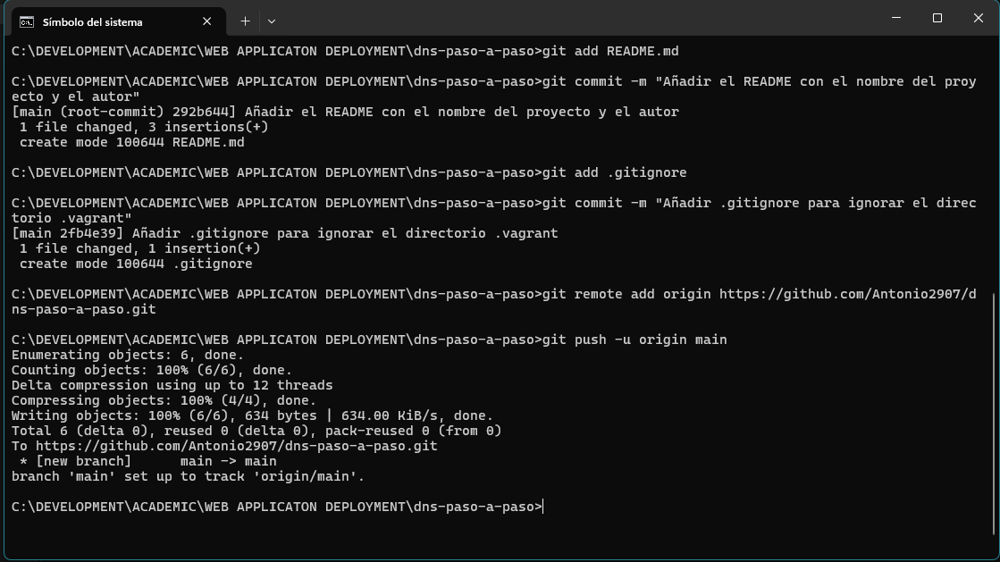

## 2. Infraestructura como código

Creamos el `Vagrantfile` con la version debian/bookworm64 y la red privada 192.168.56.10
Despues creamos la carpeta files/ donde copiaremos ficheros que vamos a copiar dentro de la máquina virtual y la carpeta 
config/ donde iremos copiando los ficheros de script necesarios paraprovisionar el servicio.
Lo siguiente que haremos sera arrancar la maquina y comprobar que la red esta correctamente

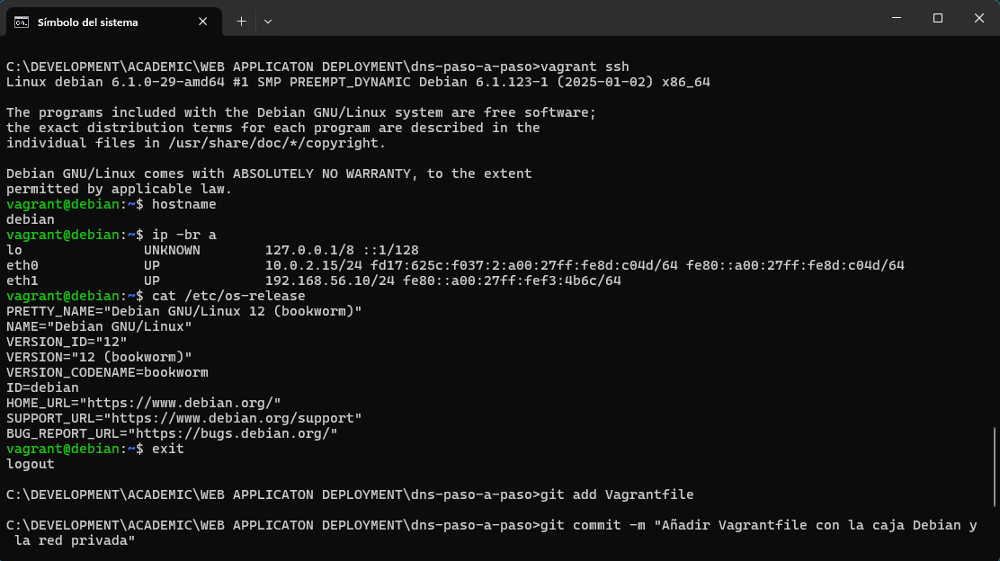

## 3. Instalación de servidor DNS

Arrancamos la maquina , accedemos con ssh y descargamos los paquetes:
- bind9
- bind9utils
- bind9-doc

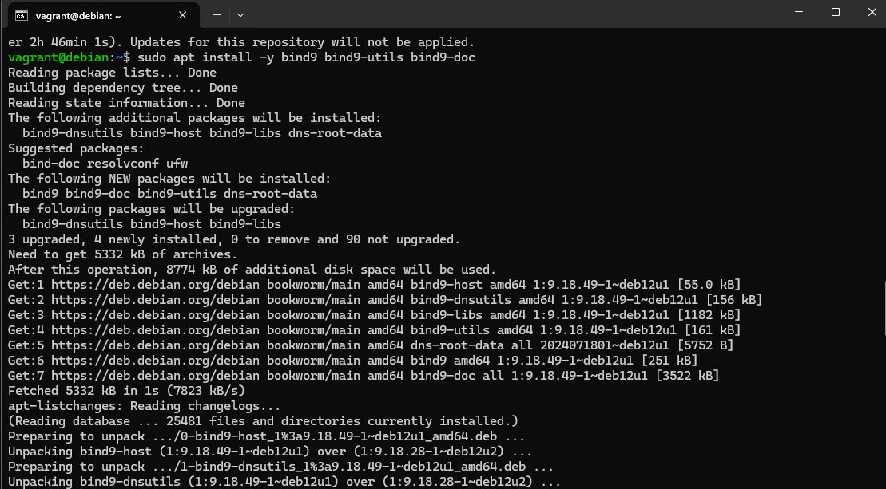
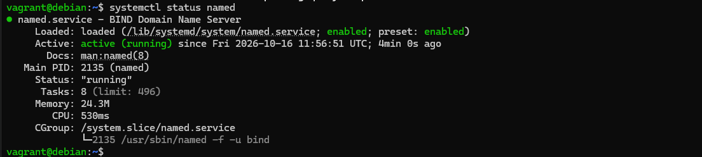

Creamos el archivo 01-instalar.sh en la carpeta config/ 
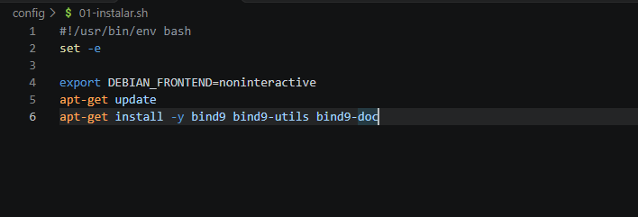

## 4. Configuración del servidor

Modificamos /etc/default/named y ponemos OPTIONS = "-u bind -4" y hacemos una copia de segurida de /etc/bind/named.conf.options

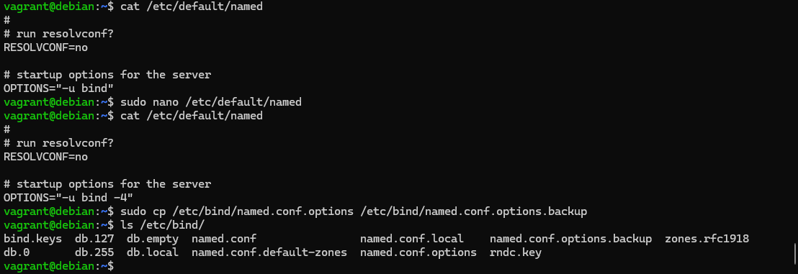

Editamos el archivo named.conf.options y comprobamos y reiniciamos que todo se a cambiado perfectamente

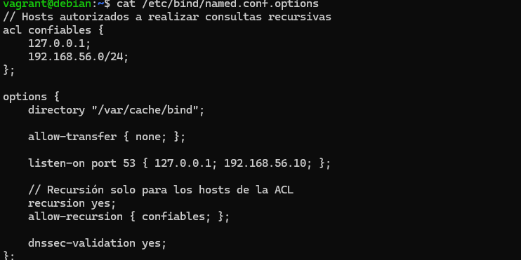
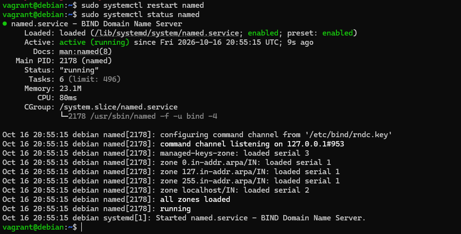

Copiamos los archivos /etc/default/named y /etc/bind/named.conf.options dentro de la carpeta files del proyecto:
cp /vagrant/files/named /etc/default/named
cp /vagrant/files/named.conf.options /etc/bind/named.conf.options

Creamos el archivo 02-opciones.sh en la carpeta config

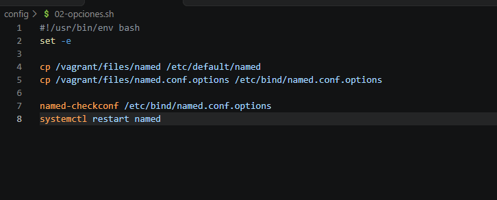

Añadimos al vagrant file este nuevo archivo que acabamos de crear.

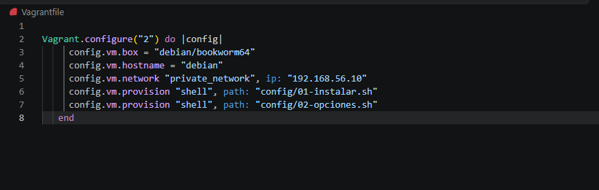

Dentro de la maquina hacemos una copia de seguridad de named.conf.local y añadimos dentro del archivo:
zone "antonio.test" {
    type master;
    file "/var/lib/bind/antonio.test.dns";
};

Despues creamos el archivo antonio.test.dns con el correspondiente contenido y ambos archivos lo copiamos dentro del proyecto.

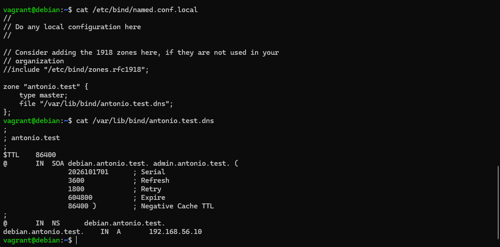

Creamos el archivo 03-zonas.sh dentro de la carpeta config

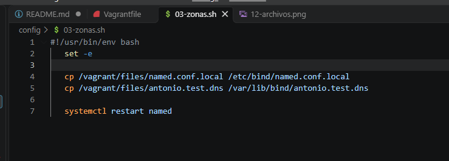

Editamos el archivo named.conf.local y añadimos:
zone "56.168.192.in-addr.arpa" {
    type master;
    file "/var/lib/bind/antonio.test.rev";
}; 

Tambien creamos el archivo antonio.test.rev con las lineas correspondientes.
Copiamos los dos archivos dentro del proyecto en la carpeta files.

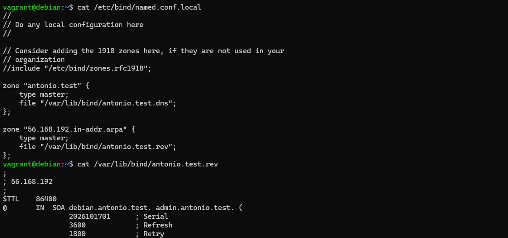
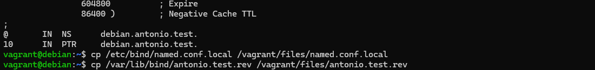

Editamos el archivo 03-zonas.sh y añadimos:
cp /vagrant/files/antonio.test.rev /var/lib/bind/antonio.test.rev

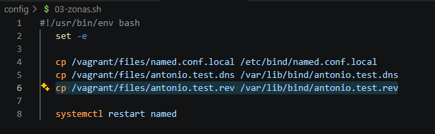

Comprobamos las configuraciones y las añadimos a 03-zonas.sh

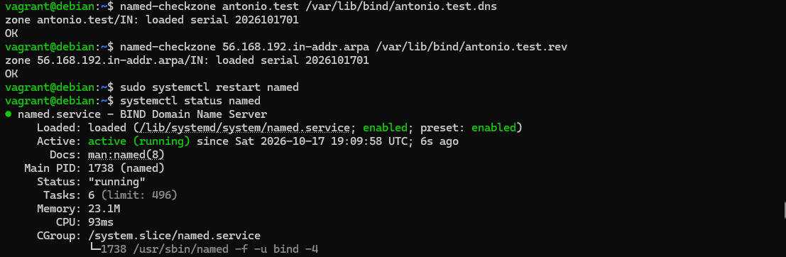
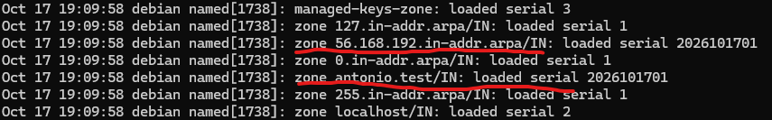

## 5 y 6. Comprobación usando dig y nslookup

Comprobamos que desde un cliente el servidor responde con dig y nslookup

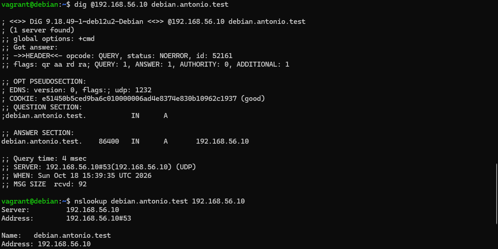
